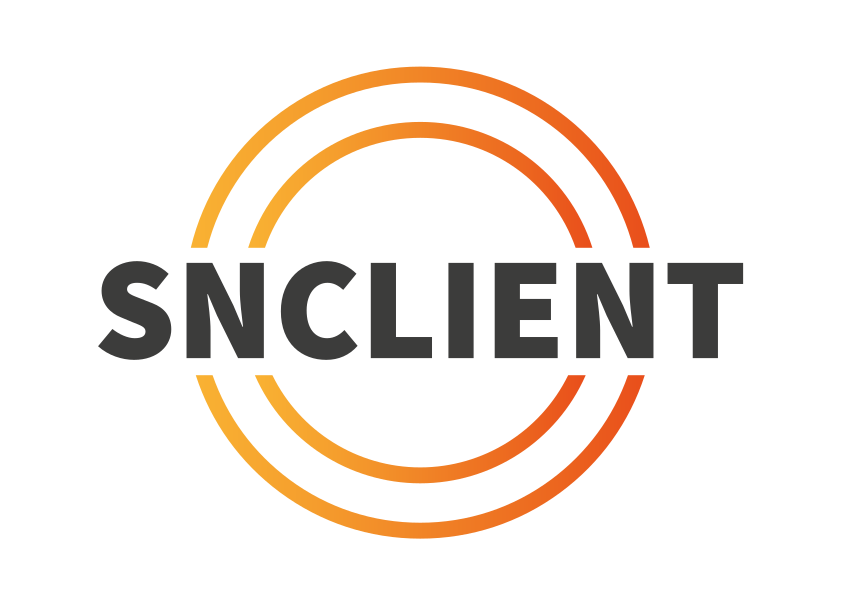

**SNClient** is an open-source, general-purpose monitoring agent designed as a replacement for NSClient++. It is a drop-in replacement for most use cases.

It was written from scratch in [Go](https://go.dev/) using today's state-of-the-art technologies. All the test and build procedures are located on [GitHub](https://github.com/ConSol-Monitoring/snclient).

It's available for Linux, Windows and macOS for i386, x86_64 and arm64 ([detailed list of supported operating systems](./install/supported/)).

Have a look at the [installation](./install/) page to get started.

## Nagios / Naemon and Prometheus

- SNClient supports the [Nagios / Naemon stack](./checks/) with NRPE or check_snclient (formerly check_nsc_web).
- Prometheus is also supported with the [built-in node_exporter and windows_exporter](./prometheus/).

## Releases

The latest release can always be found [here](https://github.com/ConSol-Monitoring/snclient/releases).

## Talks

### 2023 at OSMC Nuremberg

- [YouTube](<https://www.youtube.com/watch?v=cXXZlnmn2NA>) (EN - 33 min)
- [Slides](https://labs.consol.de/_slides/snclient-2023-11-09.pdf)
