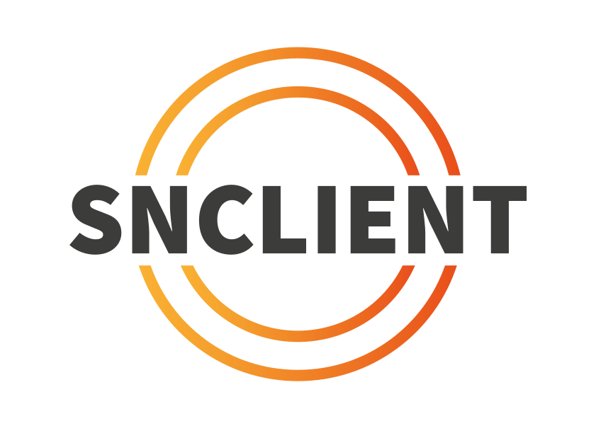
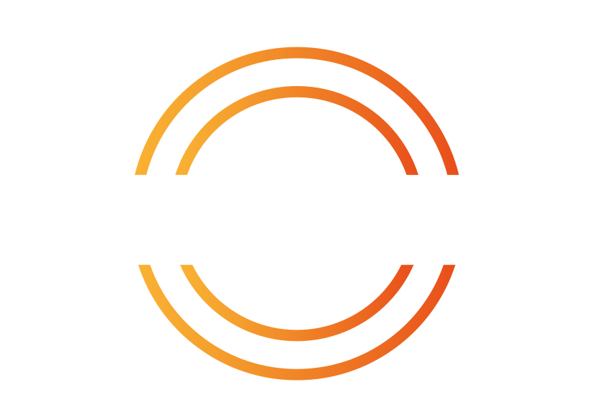

SNClient is an open-source, general-purpose monitoring agent that replaces NSClient++. It is a drop-in replacement for most use cases.

SNClient is written from scratch in [Go](https://go.dev/). All test and build procedures are on [GitHub](https://github.com/ConSol-Monitoring/snclient).

SNClient is available for Linux, Windows and macOS on i386, x86_64 and arm64. See the [detailed list of supported operating systems](./install/supported/).

Follow the [Getting Started](./getting-started/) guide to set up basic Windows monitoring with OMD and Naemon,
or see the [installation](./install/) page for all supported platforms.

## Nagios / Naemon and Prometheus

- SNClient supports the [Nagios / Naemon stack](./checks/) with NRPE or check_snclient (formerly check_nsc_web).
- SNClient supports Prometheus with the [built-in node_exporter and windows_exporter](./prometheus/).

## Releases

Download the [latest release](https://github.com/ConSol-Monitoring/snclient/releases).

## Talks

### 2023 at OSMC Nuremberg

- [YouTube](<https://www.youtube.com/watch?v=cXXZlnmn2NA>) (EN - 33 min)
- [Slides](https://labs.consol.de/_slides/snclient-2023-11-09.pdf)
