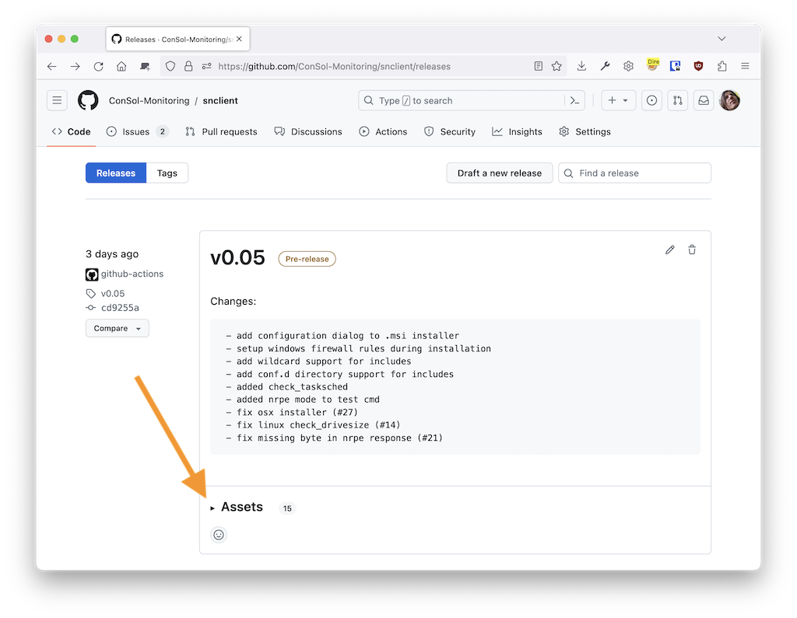
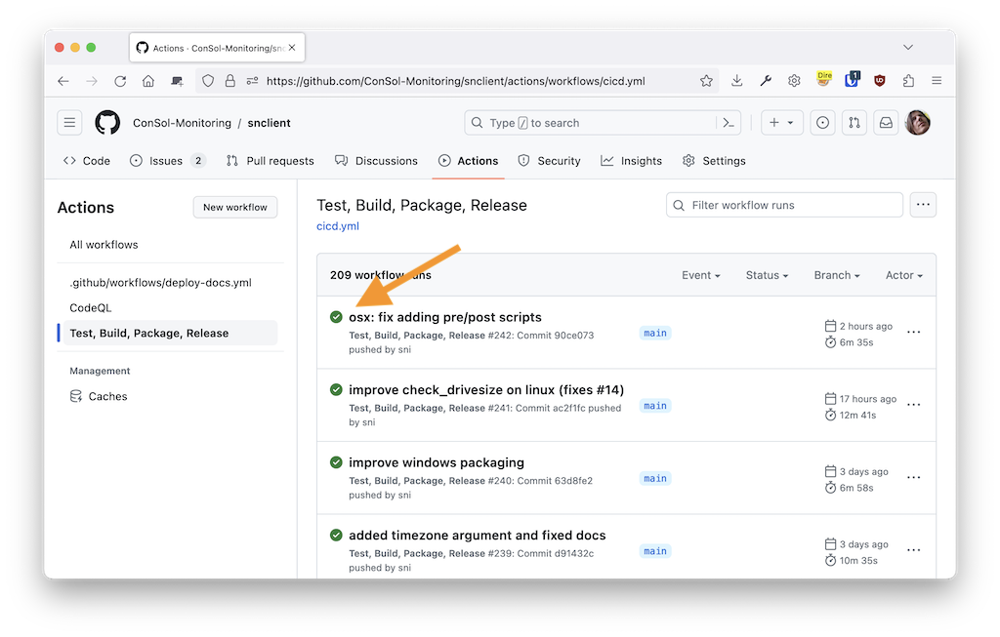
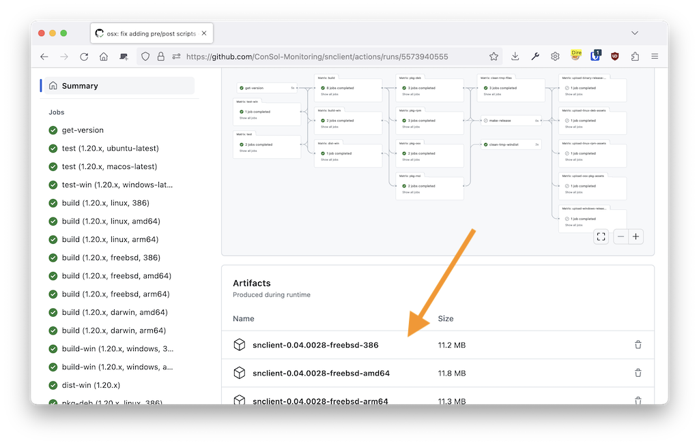

## Installation

Choose the instructions for your operating system:

- [Windows](windows)
- [RHEL/Rocky/Alma](rhel)
- [Debian/Ubuntu](debian)
- [Arch Linux](archlinux)
- [macOS](osx)

## Using Binary Packages

Use packages to install SNClient unless you need to build from source.

See the list of [supported OS distributions](supported).

### Stable Releases

Download stable release packages from:

- [SNClient Releases Page](https://github.com/ConSol-Monitoring/snclient/releases)

You might need to expand the assets to find the download links.

### Development Snapshots

During development, each code commit produces build artifacts if all tests pass.

Use stable releases unless you need to test a change or receive instructions to use a development snapshot.

To install a development snapshot:

1. Open the [SNClient GitHub Actions](https://github.com/ConSol-Monitoring/snclient/actions/workflows/builds.yml?query=branch%3Amain) page
2. Choose the first successful build, as shown below:
   
3. Scroll down and choose the download which matches your architecture:
   
4. Install just like the stable release files.

**Note:** You must log in to a GitHub account to download snapshot artifacts.

## Building SNClient From Source

See [Building from source](build) for instructions.
