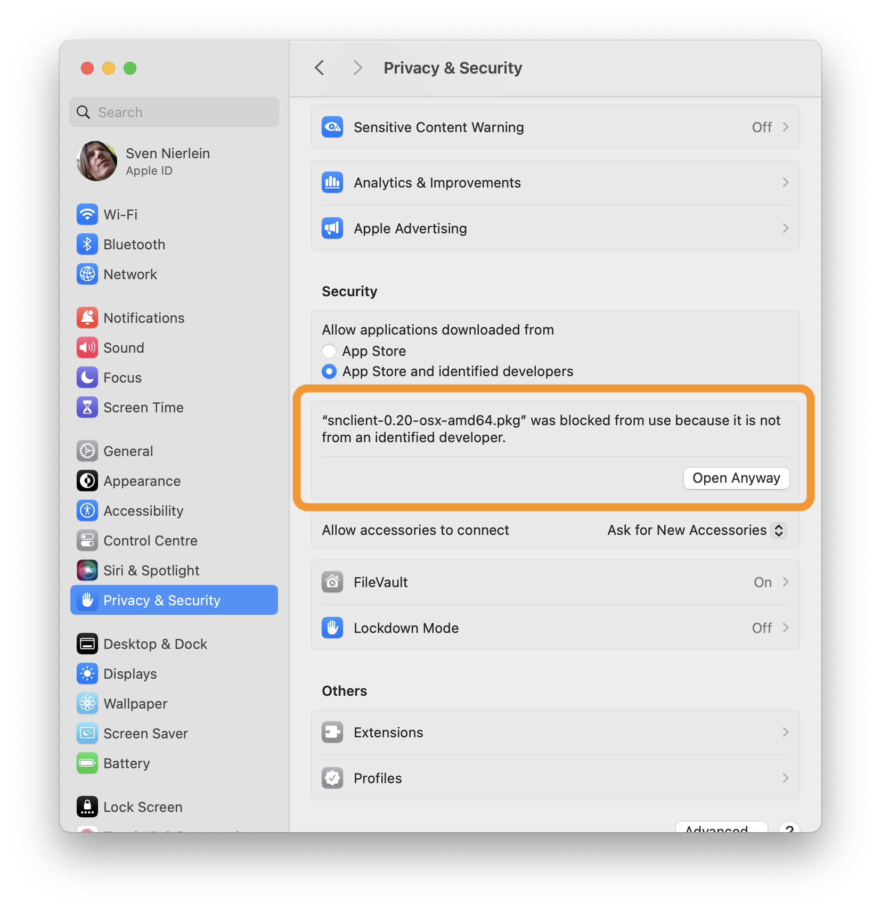
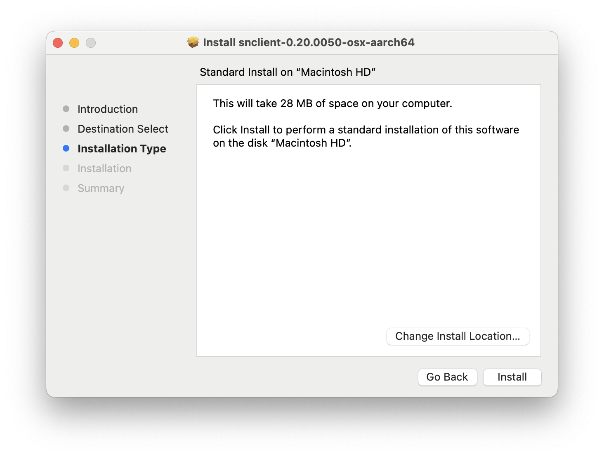

# macOS

## Installation

Download stable release packages from:

- [GitHub Releases](https://github.com/ConSol-Monitoring/snclient/releases)

Download the .pkg file from the releases page. Open the file to start the installer.
Because the package is not signed, you might need to allow it in System Settings.

This should open the installer:

### Firewall

Configure the firewall to allow these ports:

- `8443` : if you enabled the webserver (the default is enabled)
- `5666` : if you enabled the NRPE server (disabled by default)
- `9999` : if you enabled the Prometheus server (disabled by default)

## Uninstall

Uninstall SNClient using the uninstall shell script.

    %> sudo /usr/local/bin/snclient_uninstall.sh
