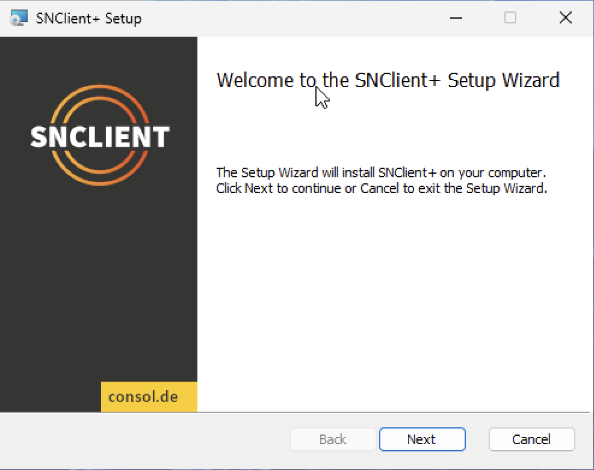

# Windows

## Installation

Stable release installation packages can be found here:

- [SNClient Releases Page](https://github.com/ConSol-Monitoring/snclient/releases)

Then start the .msi installer and follow the instructions.

### Firewall

The Windows .msi package will add the firewall exceptions automatically. If
you need to reinstall the firewall exceptions, you can run this command:

    C:\Program Files\snclient> .\snclient.exe install firewall

If you don't need the exceptions anymore, there is an uninstall command as well:

    C:\Program Files\snclient> .\snclient.exe uninstall firewall

### MSI Installation Parameters

Running the .msi installer manually lets you choose some basic options. The idea
here is to set the ports, so the following firewall setup will know which ports
to open.

All additional options should go into a local custom INI file which can be
provided during installation as well.

Running the MSI installer from the terminal with `msiexec.exe` exposes these options
as public properties.

For example:

    msiexec.exe /i snclient.msi /l*V snclient_installer.log /qn PASSWORD="test" INCLUDES="https://company.local/snclient_local.ini"

This installs the MSI package and logs everything to the snclient_installer.log file. It
also sets the initial password and includes an INI file fetched over HTTPS.

Here is a table of all available properties:

| Property             | Default Value             | Description |
| -------------------- | ------------------------- | ----------- |
| INSTALLDIR           | C:\Program Files\snclient | Set a custom install location. |
| INCLUDES             |                           | Adds include files to the /Includes section. |
| ALLOWEDHOSTS         | 127.0.0.1, ::1            | Sets the 'allowed hosts'. |
| PASSWORD             | CHANGEME                  | Sets the password (will be written to the .ini encrypted). |
| WEBSERVER            | 1                         | Enable/Disable the REST web server. |
| WEBSERVERPORT        | 8443                      | Set the port for web server. |
| WEBSERVERSSL         | 1                         | Enable/Disable TLS/SSL for the web server. |
| NRPESERVER           | 0                         | Enable/Disable the NRPE server. |
| NRPESERVERPORT       | 5666                      | Set the port for NRPE server. |
| NRPESERVERSSL        | 1                         | Enable/Disable TLS/SSL for the NRPE server. |
| PROMETHEUSSERVER     | 0                         | Enable/Disable the Prometheus web server. |
| PROMETHEUSSERVERPORT | 9999                      | Set the port for the Prometheus web server. |
| PROMETHEUSSERVERSSL  | 0                         | Enable/Disable TLS/SSL for the Prometheus web server. |

To install SNClient automatically into a custom folder, use the following command:

    msiexec.exe /i snclient.msi /qn INSTALLDIR="D:\Apps\snclient"

## Uninstall

To uninstall SNClient, run the `snclient.msi` installer again. If the installer has the same version as the
installed one, it will offer an uninstall option.

Another way is to use the Windows software center and uninstall the agent from there.
