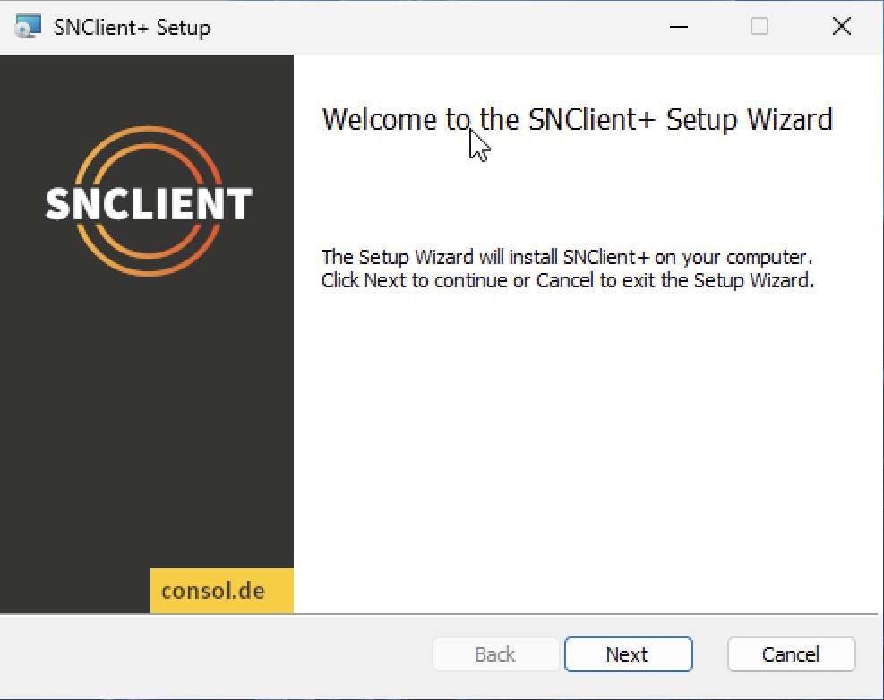

# Windows

## Installation

Download stable release packages from:

- [SNClient Releases Page](https://github.com/ConSol-Monitoring/snclient/releases)

Then start the .msi installer and follow the instructions.

### Firewall

The Windows .msi package adds firewall exceptions automatically.
If you need to reinstall the exceptions, run this command:

    C:\Program Files\snclient> .\snclient.exe install firewall

If you no longer need the exceptions, remove them with this command:

    C:\Program Files\snclient> .\snclient.exe uninstall firewall

### MSI Installation Parameters

When you run the .msi installer manually, you can choose basic options.
Set the ports so that the firewall setup opens the correct ports.

Put all additional options in a local custom INI file. You can provide this file during installation.

Running the MSI installer from the terminal with `msiexec.exe` exposes these options
as public properties.

For example:

    msiexec.exe /i snclient.msi /l*V snclient_installer.log /qn PASSWORD="test" INCLUDES="https://company.local/snclient_local.ini"

This command installs the MSI package and logs everything to the snclient_installer.log file.
It also sets the initial password and includes an INI file fetched over HTTPS.

Available properties:

| Property             | Default Value             | Description |
| -------------------- | ------------------------- | ----------- |
| INSTALLDIR           | C:\Program Files\snclient | Set a custom install location. |
| INCLUDES             |                           | Adds include files to the /Includes section. |
| ALLOWEDHOSTS         | 127.0.0.1, ::1            | Sets the 'allowed hosts'. |
| PASSWORD             | CHANGEME                  | Sets the password (will be written to the .ini encrypted). |
| WEBSERVER            | 1                         | Enable/Disable the REST web server. |
| WEBSERVERPORT        | 8443                      | Set the port for web server. |
| WEBSERVERSSL         | 1                         | Enable/Disable TLS/SSL for the web server. |
| NRPESERVER           | 0                         | Enable/Disable the NRPE server. |
| NRPESERVERPORT       | 5666                      | Set the port for NRPE server. |
| NRPESERVERSSL        | 1                         | Enable/Disable TLS/SSL for the NRPE server. |
| PROMETHEUSSERVER     | 0                         | Enable/Disable the Prometheus web server. |
| PROMETHEUSSERVERPORT | 9999                      | Set the port for the Prometheus web server. |
| PROMETHEUSSERVERSSL  | 0                         | Enable/Disable TLS/SSL for the Prometheus web server. |

To install SNClient automatically into a custom folder, use the following command:

    msiexec.exe /i snclient.msi /qn INSTALLDIR="D:\Apps\snclient"

## Uninstall

To uninstall SNClient, run the `snclient.msi` installer again.
If the installer version matches the installed version, it offers an uninstall option.

You can also uninstall the agent from the Windows software center.
