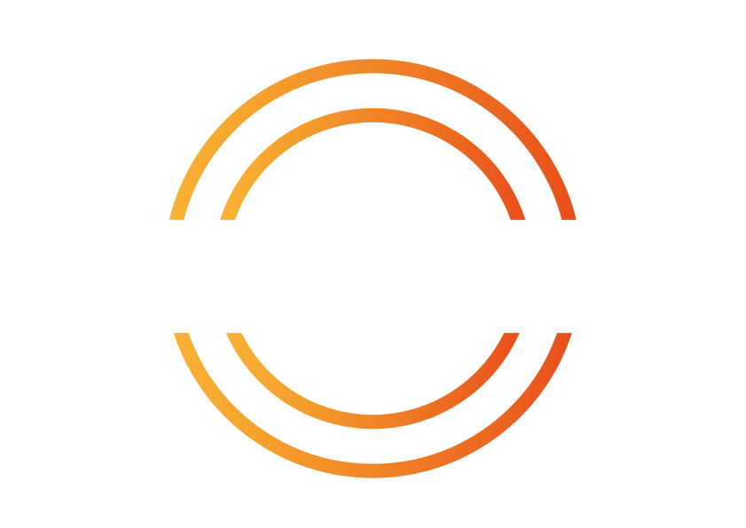

The logo can be used under the same license as SNClient itself to link back to
the SNClient homepage or source code.

  <section aria-labelledby="logo-light-mode">
    <h2 id="logo-light-mode">Light mode</h2>
    

      
    

    

      <a style="display: inline-block; padding: 0.6rem 1rem; border-radius: 6px; background: #0759b5; color: #fff; font-weight: 600; text-decoration: none;" href="snclient.png" download>Download PNG</a>
      <a style="display: inline-block; padding: 0.6rem 1rem; border-radius: 6px; background: #0759b5; color: #fff; font-weight: 600; text-decoration: none;" href="snclient.svg" download>Download SVG</a>
    

  </section>
  <section aria-labelledby="logo-dark-mode">
    <h2 id="logo-dark-mode">Dark mode</h2>
    

      
    

    

      <a style="display: inline-block; padding: 0.6rem 1rem; border-radius: 6px; background: #0759b5; color: #fff; font-weight: 600; text-decoration: none;" href="snclient_dark.png" download>Download PNG</a>
      <a style="display: inline-block; padding: 0.6rem 1rem; border-radius: 6px; background: #0759b5; color: #fff; font-weight: 600; text-decoration: none;" href="snclient_dark.svg" download>Download SVG</a>
    

  </section>

